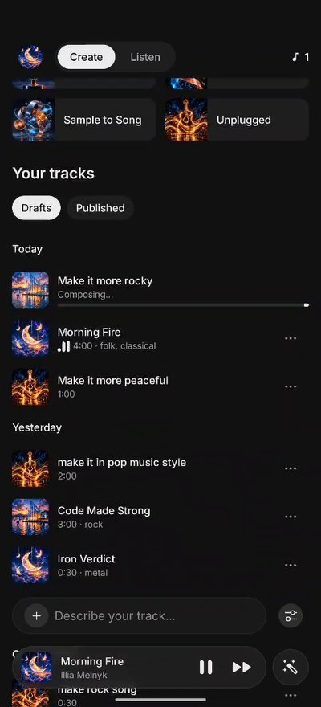
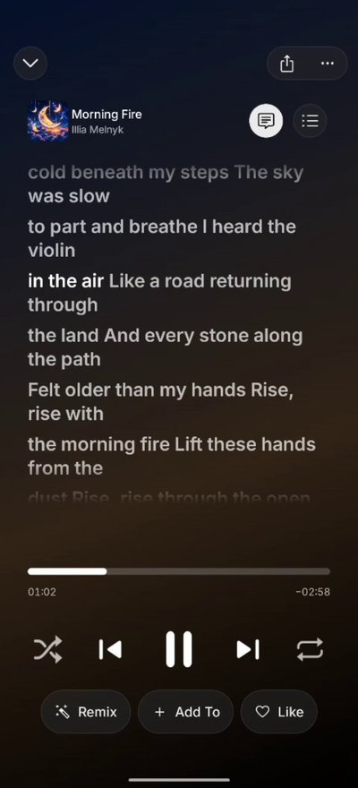
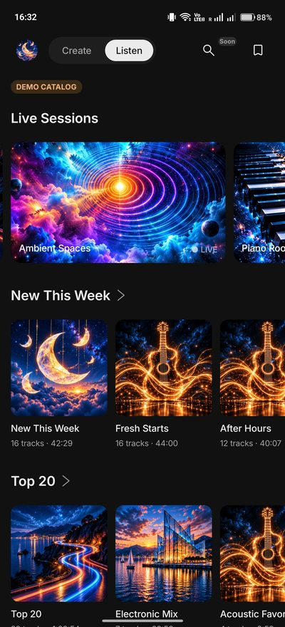
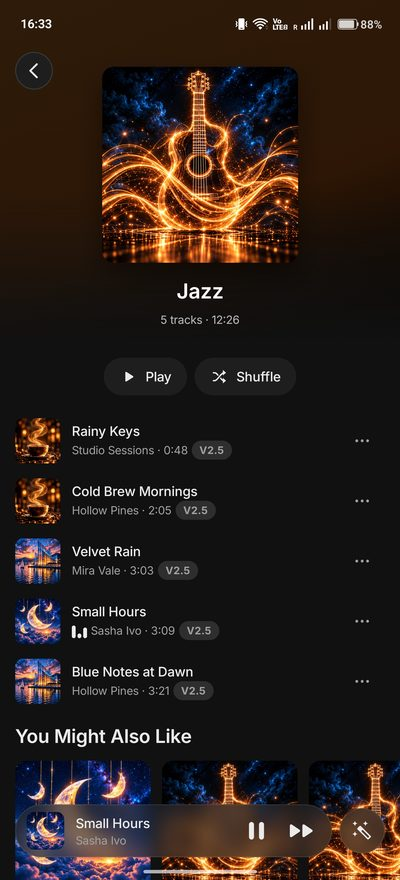
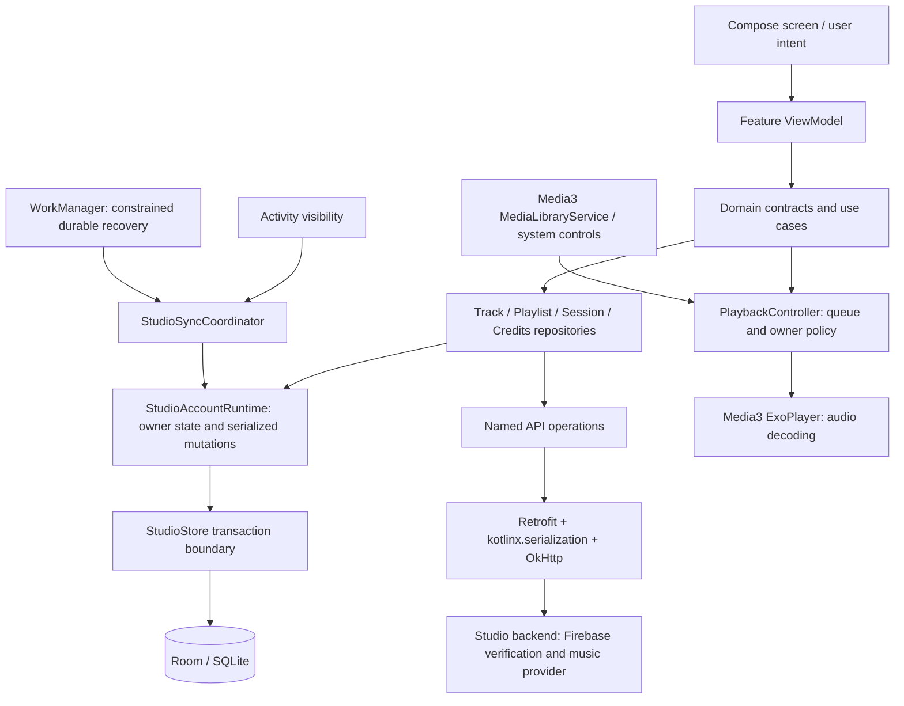
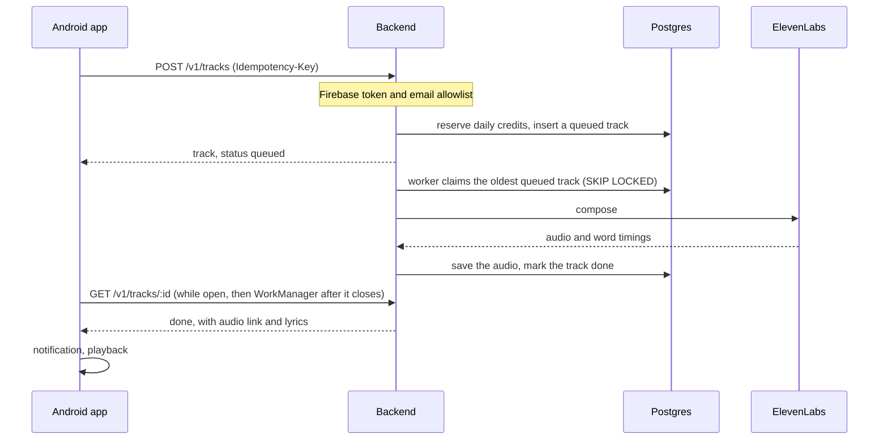

# Studio

[](https://github.com/IlliaMel/music-studio-preview/actions/workflows/android.yml)
[](https://github.com/IlliaMel/music-studio-preview/actions/workflows/backend.yml)
[](LICENSE)

**An Android app and its backend for the [Eleven Music API](https://elevenlabs.io/docs/overview/capabilities/music).** Describe a song or hum the idea. The track is composed in the background, and then you can listen with word-synced lyrics, remix it, like it and keep it in playlists.

> **Unofficial prototype.** Not affiliated with, endorsed by, or connected to ElevenLabs.

Built solo in about seven working days in October 2026: the Android app, the backend and the design system. The production build generates with the real ElevenLabs API, while the Listen tab is a demo catalog. There is no public APK, so watch the videos or [run it locally](#run-it-locally) with the mock backend.

**Stack:** Kotlin · Jetpack Compose · Media3 · Room · Koin · WorkManager · Node.js · TypeScript · Postgres

https://github.com/user-attachments/assets/3cd760ab-1728-49a7-9845-987bc12c7ee3

<p align="center">
  
  
  
  
</p>

**Contents:** [What it does](#what-it-does) · [What works well](#what-works-well) · [How it is built](#how-it-is-built) · [Key decisions](#key-decisions) · [Accessibility and security](#accessibility-and-security) · [Dev and prod](#dev-and-prod) · [Run it locally](#run-it-locally) · [What I would improve](#what-i-would-improve) · [What I would build next](#what-i-would-build-next)

## What it does

| | |
|---|---|
| **Create** | A composer with duration, vocal or instrumental, your own lyrics, model (Music v2 or v2.5) and one or two variants. Six tools, such as Voice to Song, Genreshift and Sample to Song, turn a recorded or imported idea into a song. Your own finished tracks can be remixed: the remix keeps the original's words and changes its style. |
| **Generation** | Runs on the server. The app shows progress, keeps tracking it after the app is closed and posts a notification when the track is ready. Drafts can be renamed, shared or saved as MP3. |
| **Listen** | A demo catalog: Live Sessions (endless stations), New This Week, Top 20, genres and moods, collections with Play and Shuffle, and "You Might Also Like". |
| **Player** | Background playback with lock-screen and notification controls, lyrics that follow each sung word, a queue, shuffle, repeat and a mini player. |
| **Library** | Liked tracks and playlists, opened from the bookmark icon on Listen. |
| **Account** | Google sign-in, invite-only generation, daily credits, light and dark themes, and account deletion that also clears the server. |

Features outside this prototype's scope (Muse, Styles, Sounds, Search, publishing) are marked **Soon**. Each opens a short explanation of how it would work, rather than leading to a dead end.

Recorded on a phone against the production backend:

**Creating and listening** (2:06): a track composing, the ready notification, lyrics, a tool, Listen and the library

https://github.com/user-attachments/assets/7028d2d5-53f9-4e04-9273-ce95f29179e0

**Player and tools** (1:11): the queue, word-synced lyrics, remix and the Voice to Song tool

https://github.com/user-attachments/assets/e30aa87a-46f1-47f2-b3bc-d8c07816d3e5

## What works well

- **Paid calls are safe by design.** The ElevenLabs key never leaves the server. Every generation attempt carries an idempotency key, so a retry after a dropped connection returns the same track instead of paying twice. Paid calls are never retried automatically. When the outcome is unclear, the track ends as `PROVIDER_OUTCOME_UNKNOWN` instead of being sent, and paid for, a second time. An email allowlist is checked on every request, and a daily limit per user and a global daily budget are enforced under database locks. With ElevenLabs and Firebase sign-in, the server refuses to start unless the allowlist and the budget are configured.
- **Queued work survives restarts.** The queue is a Postgres table that workers claim with `FOR UPDATE SKIP LOCKED`, so nothing queued lives only in memory. A paid generation interrupted mid-flight is marked `PROVIDER_OUTCOME_UNKNOWN` rather than sent again (see [improvement 3](#what-i-would-improve)). On the phone, foreground polling and WorkManager pick the work up again after the app is killed or the network comes back.
- **Local data with one owner.** The UI reads tracks, playlists and likes from Room. Pending generation requests are kept in a local journal with their idempotency key, so a retry after a crash cannot pay twice. All repositories share one account runtime, so sign-out, account deletion, playback and pending requests agree on whose data is active.
- **A real media app.** Media3 `MediaLibraryService` provides background playback and system controls. The app's own queue policy handles stations, repeat, shuffle and resuming playback.
- **Its own design system.** It is built on Compose foundation rather than Material 3 and styled after ElevenLabs: design tokens, about 50 components, and tests for semantics and touch targets. Debug builds add a second launcher, **Studio UI Kit**, that shows every component in both themes.
- **Clear boundaries.** Screens follow `Contract → ViewModel → Route → Screen`. The domain layer has no Android imports and features never import each other; today this is kept by convention and review (see [improvement 4](#what-i-would-improve)), while a test of the Koin graph catches a missing binding. CI runs formatting, Lint with warnings treated as errors and 800+ Android unit tests (JVM and Robolectric). For the backend it runs lint, typecheck, 340+ tests on a real Postgres engine, including race tests with concurrent connections, a migration check and a Docker build.
- **Two apps side by side.** The `dev` and `prod` flavors install together. The mock provider can act out each failure (`[mock:credits]`, `[mock:rate_limit]`, …) so every error screen can be checked without spending credits.

## How it is built

### Repository

```
app/                    Android app: Kotlin, Jetpack Compose, one Gradle module
  src/main/kotlin/com/illiamelnyk/studio/
    core/               ui (design system), domain, data (Room, Retrofit, playback, sync),
                        presentation (shared screen parts), artwork
    feature/            auth, create, listen, player, library, profile: one package each
    navigation/         Navigation 3 shell: Create | Listen switch with a back stack per tab
    di/                 Koin modules
backend/                Node.js 24 + TypeScript: Hono, zod, Drizzle ORM on Postgres
  src/core/             config, auth, database, HTTP, audio storage
  src/features/         users, tracks, library, recordings: table → repository → service → routes
build-logic/            a Gradle convention plugin: SDK levels, Kotlin, Lint, Compose
public-fixtures/        the demo catalog: one source for the app and the backend
tools/                  sync-catalog-fixture.mjs generates their copies of that catalog
.github/workflows/      CI for the app and for the backend
```

### Android

Kotlin 2.4, Jetpack Compose, Navigation 3, Koin, Room, Retrofit with kotlinx.serialization and OkHttp, Media3 (ExoPlayer and session), WorkManager, Credential Manager with Firebase Auth. Minimum SDK 26, target SDK 37.



- **Persistence.** Room keeps typed rows for the account, tracks, playlists, memberships, likes and the operation journal. A write updates only the rows that changed. An unreadable pending paid request is blocked rather than silently given a new idempotency key.
- **Networking.** Each API call is a named method on a typed Retrofit endpoint, and DTOs are mapped to domain values in the repositories. Firebase tokens and audio authorization stay in the data layer. Redirects are disabled for authenticated requests.
- **Playback.** The application controller owns the queue, repeat, shuffle, stations and the account boundary. A session adapter translates system controls and publishes sanitized metadata.

### One generation, end to end



### Backend

Each feature is a folder with a table, a repository (SQL only), a service (rules, no HTTP) and thin routes. Every error has the same shape, every response carries a request ID that also appears in the logs, and secrets are redacted from them. Migrations are plain SQL files reviewed with the code and applied when the server starts. Details are in [backend/README.md](backend/README.md), with [LIVE_SETUP.md](backend/LIVE_SETUP.md) for live generation, [RECORDINGS.md](backend/RECORDINGS.md) and [REMIX.md](backend/REMIX.md).

## Key decisions

| Decision | Why |
|---|---|
| The phone talks to my backend, never to ElevenLabs | The API key stays on the server, and limits, idempotency and retry rules live in one place. |
| A Postgres table is the generation queue | No extra infrastructure: `SKIP LOCKED` gives safe concurrent workers, and the queue survives restarts. |
| The app polls instead of receiving pushes | The fewest moving parts for a prototype. Push is [improvement 2](#what-i-would-improve). |
| Koin instead of Hilt | No annotation processing in a one-module app; a test checks the whole graph instead. |
| Compose foundation instead of Material 3 | The ElevenLabs look without fighting Material defaults. |
| One Gradle module | A small build and navigation setup at this size. The split is [improvement 4](#what-i-would-improve). |
| Native Android now, Kotlin Multiplatform when iOS is needed | The domain layer has no Android imports, and Koin, Room, kotlinx.serialization and coroutines already run on iOS, so the domain and most of the data layer can be shared through KMP. Retrofit would become Ktor, while playback and background work stay native: Media3 and WorkManager here, AVFoundation and background tasks on iOS. |
| The app owns the queue, ExoPlayer only plays | Stations, the account boundary and resume rules have one policy instead of living in the player. |
| A remix is planned before it is composed | ElevenLabs' free plan endpoint turns "the original plus the requested change" into real style tags, and the remix keeps the original's words. |

## Accessibility and security

- **Touch and screen readers.** Interactive components have at least a 48 dp touch target and a semantic role, both checked by tests. Controls carry spoken labels such as "Play Glass Harbor".
- **Large text.** Tests render the composer, chips, sheets, the mini player and the full player at larger font scales.
- **Themes.** Light, dark or the system setting.
- **Network.** Release builds accept HTTPS only. Plain HTTP is allowed solely for local addresses in the dev debug build. Authenticated requests do not follow redirects.
- **Secrets.** The ElevenLabs key exists only on the server. Firebase tokens are never written into stored tracks or playback state, and Android backup is turned off for app data.
- **Server.** Every request checks the Firebase token, including whether the account was revoked or disabled. Logs redact secrets, and the container runs as a non-root user.
- **Release.** R8 shrinks and obfuscates the code and removes unused resources.

## Dev and prod

| | dev | prod |
|---|---|---|
| Android app | **Studio Dev**, `com.illiamelnyk.studio.dev` | **Studio**, `com.illiamelnyk.studio` |
| Sign-in | Local development token in the debug build; Google through Firebase on a hosted dev backend | Google through Firebase |
| Music | Mock provider: fast, free, with scripted failures | ElevenLabs Music API |
| Database | PGlite (Postgres in WebAssembly) locally, Postgres when hosted | Postgres |
| Limits | A daily limit per user (25 by default); allowlist and paid budget optional | Email allowlist, 5 generations per user per day, 10 paid requests per day in total |
| Firebase | Shared project; deleting a dev account keeps the Google identity | Same project; deleting an account removes the identity |

**Where prod runs today.** The repository is ready for Railway: a Dockerfile, `backend/railway.json` and a step-by-step guide in the backend README. For the demo, the production backend runs on my own machine with Node.js and Postgres, behind a Cloudflare Tunnel, and generates with the real ElevenLabs API. A quick tunnel gets a new address every time it starts, and the address is built into the APK, so a fixed domain is the first item on the list below.

**Measured on prod.** From request to finished audio, a 30–60 second track takes 4–6 seconds and a 2–4 minute track 9–19 seconds. The production release APK is about 32 MB.

## Run it locally

You need JDK 17 or newer, the Android SDK and Node.js 24 or newer.

```sh
cd backend
npm ci
npm run dev                  # http://127.0.0.1:8787: mock provider, data in backend/data

./gradlew assembleDevDebug   # from the repository root
```

Install **Studio Dev** on an emulator and choose **Continue with local server**: the emulator reaches the computer at `10.0.2.2:8787`. Add `[mock:credits]`, `[mock:rate_limit]`, `[mock:server]`, `[mock:slow]` or `[mock:bad_prompt]` to a prompt to see that failure.

```sh
./gradlew check              # formatting (Spotless + ktlint), Android Lint, unit tests
./gradlew spotlessApply      # fix formatting
cd backend && npm run check  # Biome, typecheck, tests
```

CI additionally checks that migrations match the schema, runs the race tests on a real Postgres server and builds the Docker image.

### Build configuration

Builds for a hosted backend read their settings from your user-level `~/.gradle/gradle.properties`, outside the repository:

```properties
studio.dev.apiBaseUrl=https://development.example.com
studio.prod.apiBaseUrl=https://production.example.com
studio.dev.firebaseAppId=<development-firebase-app-id>
studio.prod.firebaseAppId=<production-firebase-app-id>
studio.firebaseApiKey=<firebase-api-key>
studio.firebaseProjectId=<firebase-project-id>
studio.googleWebClientId=<google-web-client-id>

studio.release.storeFile=/path/to/release.jks
studio.release.storePassword=<keystore-password>
studio.release.keyAlias=<key-alias>
studio.release.keyPassword=<key-password>
```

The variants are `assembleDevDebug`, `assembleDevRelease`, `assembleProdDebug` and `assembleProdRelease`. Without `studio.dev.apiBaseUrl`, the dev debug build signs in locally; `-Pstudio.dev.apiBaseUrl=` (empty) forces local sign-in for a single build. Release builds are signed only when all the signing properties are set, so CI builds every variant without credentials. Keystores, passwords and Firebase credentials stay out of version control. Firebase setup is described in [app/docs/FIREBASE-AUTH.md](app/docs/FIREBASE-AUTH.md).

## What I would improve

In order of priority:

1. **A fixed production address.** Use a named tunnel or Railway with a fixed domain. Today every new tunnel means a new APK.
2. **Push instead of polling.** Report finished tracks through FCM (or server-sent events while the app is open). Today the app polls the track and the profile every few seconds during a generation.
3. **Audio storage and the worker.** Audio files sit on the server's disk, which limits the backend to one instance. Move them to object storage (S3 or R2) with signed links and a CDN. Run the generation worker apart from the API, so that a deploy does not interrupt paid generations, which currently end as `PROVIDER_OUTCOME_UNKNOWN`.
4. **Gradle modules.** One module keeps the build simple, but feature boundaries are enforced by convention and review. When the team grows, split `core:domain`, `core:data` and `core:playback` first, then feature API and implementation modules.
5. **Data at scale.** Repositories compare an in-memory copy of the account's whole library, so cost grows with its size: one like reads the library several times. Paging, smaller Room queries and targeted updates would fix that.
6. **The player.** The playback controller is a large coordinator; the queue policy and resumption can move out. ExoPlayer receives one track at a time, so there is no gapless playback or preloading.
7. **Recording and uploads.** Move MediaRecorder setup off the main thread. Stream uploads instead of holding up to 20 MB in memory, and clean up abandoned references.
8. **Process death.** Keep the composer draft (prompt and settings) in `SavedStateHandle`.
9. **Tests on real devices.** Unit tests run on fakes. Add instrumented and screenshot tests, a Macrobenchmark with a baseline profile, and an end-to-end run against the mock backend in CI.
10. **Observability.** Crash reporting and product analytics in the app, and backend metrics with alerts on provider errors and spend.

## What I would build next

In the order I think matters most for users:

1. **Better results on the first try.** An "Enhance prompt" button and **Muse**, a chat helper that turns a vibe, a reference track or a lyric idea into a composition plan. It would be a language model with tools on top of the free `/v1/music/plan` endpoint. Every track should also get a generated title and cover; plan-based generations come back without a title, so the app shows the prompt instead. *Measure:* generations per kept track (a track is kept when it is played again, liked or shared).
2. **Edit instead of regenerate.** Regenerate one section (inpainting), extend a track, and split it into stems (`/v1/music/stem-separation`) for a DAW. This saves credits and matches how musicians work. *Measure:* credits spent per finished track, and the share of changes made as edits.
3. **Publish and share.** An artist profile, the Published tab, public track links, and short vertical videos with lyrics and a waveform, rendered on the device with Media3 Transformer. This is the growth loop. *Measure:* shares per published track and installs that come from shared links.
4. **A real Listen tab.** Replace the demo catalog with published tracks. Add search, recommendations based on likes, and remix chains that credit the original. *Measure:* weekly listening time per user and remixes of other people's tracks.
5. **Sounds and Styles.** Loops and one-shots from the Sound Effects API, and custom styles trained on your own audio where the plan allows fine-tuning. *Measure:* the share of tracks that use a sound or a custom style, and 30-day retention of the people who make them.
6. **Monetization.** Free daily credits plus a subscription through Google Play Billing, with entitlements checked on the server and a clear paywall instead of an error when credits run out. *Measure:* conversion from free to paid, and generation cost against revenue per paying user.

## Third-party

- [Inter](https://github.com/rsms/inter) by Rasmus Andersson, from [Google Fonts](https://github.com/google/fonts/tree/main/ofl/inter): SIL Open Font License 1.1, in `app/src/main/assets/licenses/inter-OFL.txt`.
- [Material Symbols](https://github.com/google/material-design-icons) by Google, converted to vector drawables: Apache License 2.0, in `app/src/main/assets/licenses/material-symbols-LICENSE.txt`.
- Cover art is AI-generated for this project; prompts and hashes are in `app/src/main/assets/licenses/studio-generated-artwork.md`. The demo catalog is fictional, and its audio is synthesized locally rather than generated by ElevenLabs.
